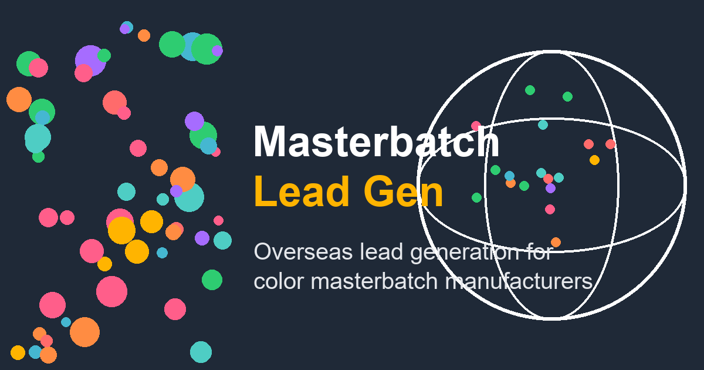

<p align="center">
  
</p>

# Masterbatch Lead Gen 🎨

> **Turn your AI assistant into a 24/7 overseas sales team for masterbatch manufacturers.**

An AI **Skill** for overseas lead generation in the masterbatch industry. It turns the "find → score → outreach → track" export sales loop into a reusable methodology + prompt library that turns your AI assistant into a 24/7 foreign-trade team.



> **This is a methodology + prompt + knowledge Skill, not an app.** It runs inside any Skill-compatible AI assistant (WorkBuddy, Claude, Cursor, etc.) and reuses the assistant's built-in web search, file I/O, and scheduling — no backend, database, or desktop app required.

🌐 **Language**: English (this file) · 简体中文见 [SKILL.md](SKILL.md) 与 `references/`（均为中文）

## Who is this for?

Manufacturers of:
- **Custom color masterbatch** (tailored to resin, color, and processing)
- **Color matching / proofing** (physical swatch, Pantone, RAL)
- **Flame-retardant masterbatch** (independent product line)

Targeting overseas markets: Southeast Asia (Vietnam, Thailand, Indonesia), Middle East (Türkiye, Saudi Arabia), Latin America (Brazil, Mexico), Europe, and beyond.

## What it does

A complete export lead-gen loop, expressed as agent "roles":

| Role | Job |
|---|---|
| 🎯 Market Research Agent | Country analysis, entry strategy, local-language keywords |
| 🗺️ Map Scraping Agent | Pull local prospects via browser script `tools/maps_scrape.py` |
| 🔍 Prospecting Agent | Discover overseas companies via web search |
| 📄 Website Research Agent | Extract public info, emails & buyer hints |
| ✍️ Business Communication Agent | Draft multilingual emails / WhatsApp / LinkedIn copy |
| 🧮 Lead Evaluation Agent | Score and grade leads (A/B/C) |
| 👔 General Manager Agent | Summarize, flag risks, compliance review |

```
① Market research → ② Google Maps scraping → ③ Prospect discovery
  → ④ Website deep-dive → ⑤ Lead scoring → ⑥ Outreach draft
  → ⑦ Multi-channel outreach (email/WhatsApp/LinkedIn) → ⑧ Track & audit
```

> **Pragmatic automation**: the AI does all the heavy lifting (scraping, filtering, writing, tracking, auditing), but **outbound sends (email / WhatsApp / LinkedIn) are always done manually by the human** — this keeps your accounts safe from platform bans.

## Quick start

1. **Install** the Skill (see [Installation](#installation) below).
2. Run a full loop:

```
Run a complete masterbatch overseas lead-gen loop for Vietnam:
products = custom color masterbatch + flame-retardant masterbatch.
1. Market research (Vietnamese keywords)
2. Discover 20 plastic processors using Vietnamese keywords
3. Score and grade the leads
4. Draft Vietnamese outreach emails for the top 5
5. Compile results into a local CSV lead sheet
```

## Installation

The skill ships with the whole toolchain (`tools/`), a workspace initialiser
(`init_workspace.py`) and seed templates (`templates/`). Nothing else is required
besides Python 3.8+.

```bash
# 1. Install the skill
cp -r masterbatch-lead-gen ~/.workbuddy/skills/masterbatch-lead-gen

# 2. Create a working directory (scripts + empty lead pool + 50-market plan)
python ~/.workbuddy/skills/masterbatch-lead-gen/init_workspace.py "D:////my-leadgen"

# 3. Fill in your own identity (REQUIRED before any outreach)
#    <workdir>\tools\profile.json        your name / company / email / WhatsApp
#    references/company-profile.md        your real capacity, certifications, years
```

Then, inside the working directory:

```bash
python tools/pick_market.py                       # which market today (main / wa track)
python tools/kwgen.py --country Germany --cities 3 --cmd   # local-language queries
python tools/build_followup_html.py               # build the daily follow-up desk
```

**Directory convention**: `tools/` must sit next to `master-lead-pool.csv`.
Scripts locate data via `MB_HOME` env var, else the parent of the script itself.

### Other assistants

Copy `SKILL.md` + `references/` and paste `SKILL.md` as instructions; the
pipeline scripts still need Python, so `init_workspace.py` applies the same way.

## Repository layout

```
SKILL.md                          # Skill entry: roles, loop, hard rules, deployment
README.md                         # This file
LICENSE                           # MIT
CONTRIBUTING.md                   # Contribution guide
logo.png                          # Logo
cover-banner.png                  # Social cover banner
_icon.png                         # SkillHub icon
init_workspace.py                 # Create a ready-to-run working directory
启动工作台.bat                      # Windows: launch the follow-up workbench
start-workbench.sh                # macOS/Linux: launch the follow-up workbench
smtp_config.example.json          # SMTP config template (no real secrets)
.env.example                      # Optional env var template
tools/                            # The pipeline scripts (single source of truth)
  kwgen.py                        #   local-language query generator (city rotation)
  maps_scrape.py                  #   Google Maps sharded scraper
  classify_leads.py               #   3-level screening (real factory vs trader vs peer)
  site_deepdive.py                #   open real sites, grab products / contacts / socials
  schema_check.py                 #   21-column schema + 7-dim score validator
  import_leads.py                 #   4-key dedup import (backup + fill-blanks-only)
  find_whatsapp.py                #   wa.me crawler + mobile-prefix inference
  render_wa_worklist.py           #   click-to-verify WhatsApp worklist
  outreach_copy.py                #   WhatsApp 2-liner + full email copy library
  build_followup_html.py          #   per-customer follow-up desk (single HTML)
  sync_followup.py                #   write human progress back into the pool
  pick_market.py                  #   market selector (main / WhatsApp-Friday tracks)
  render_report.py                #   daily HTML report
  render_kwlib.py                 #   keyword library dashboard
  workbench.py                    #   local customer workbench server (http://127.0.0.1:8610)
  workbench.html                  #   workbench front-end
  profile.example.json            #   your identity template (fill in before outreach)
  data/map_keywords.json          #   48 markets x 20 languages x 12 industries
templates/
  market-plan.template.csv        #   50-market plan seed
  pool.template.csv               #   21-column lead pool header
references/                       # Deep-dive guides (see "What it does")
examples/                         # Sample outputs and prompt recipes
```

## The customer workbench 🖥️

Besides the pipeline scripts, the skill ships a **local customer workbench** — a
single-file web server that turns your lead pool into a visual follow-up desk:

```bash
cd <your-workdir>
python tools/workbench.py          # or double-click 启动工作台.bat / ./start-workbench.sh
# then open http://127.0.0.1:8610
```

- **Local only** — binds `127.0.0.1`, never exposed to the internet.
- **Follow-up status** is stored in a local SQLite DB (`workbench.db`), not the browser.
- **SMTP sending** is optional: fill `smtp_config.json` (from `smtp_config.example.json`)
  with your own mailbox + app password if you want the workbench to send email drafts.
- Your identity (name/city/company) for the WhatsApp openers is read from
  `tools/profile.json` — never hard-coded.

## Safety boundaries (non-negotiable)

- **Never fabricate** company names, URLs, emails, or certifications.
- **Outbound sends are never automated** — emails, WhatsApp and LinkedIn are human-sent; the AI only prepares copy.
- **No unofficial WhatsApp automation / LinkedIn scraping** (platform bans).
- **Customer data stays local** — never commit it to a public repo.
- **Local-language first** — outreach & keywords in the prospect's language.

## Contributing

Contributions are welcome — especially new languages and outreach templates. See [CONTRIBUTING.md](CONTRIBUTING.md).

## License

[MIT](LICENSE)
